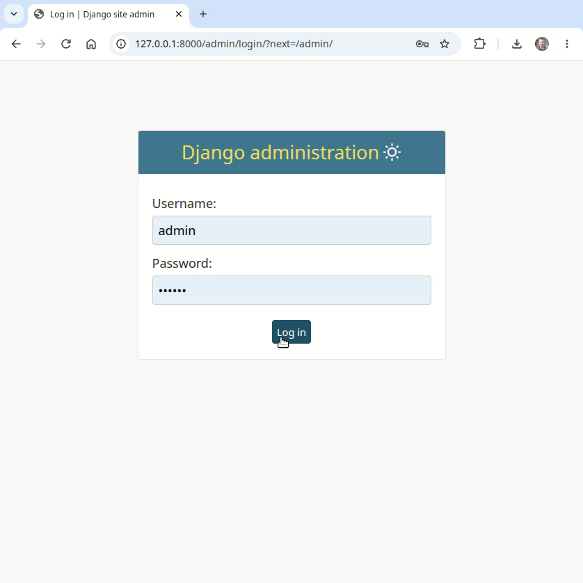

# LMS based on Django and Tailwind CSS

Install:

```
git clone git@github.com:kamuz/django-lms.git
cd django-lms
python -m venv myenv
source myenv/bin/activate
pip install -r requirements.txt
python manage.py runserver
```

Demo:

